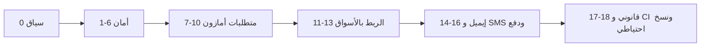

# أوامر AI Studio لإكمال مشروع OrderFlow

## طريقة الاستخدام (مهم تقراها الأول)

1. **ابدأ بالأمر رقم 0** (سياق المشروع). الصقه أول مرة في المحادثة عشان AI Studio يفهم قواعد المشروع.
2. **ابعت أمر واحد بس في كل مرة**، وبنفس الترتيب. ما تجمعش أكتر من أمر في رسالة واحدة، لأن الجودة بتقل جامد.
3. **بعد كل أمر:** اتأكد إن الموقع شغال، وإن `npm test` بيعدّي، واعمل commit على GitHub قبل ما تبعت الأمر اللي بعده.
4. الأوامر مكتوبة **بالإنجليزي عن قصد**، لأن AI Studio بيكتب الكود بدقة أعلى بالإنجليزي. واجهة الموقع هتفضل عربي زي ما هي.

> [!WARNING]
> فيه حاجات **AI Studio ما يقدرش يعملها**، ولازم تعملها إنت بنفسك:
> - إنشاء ملف `package-lock.json`: شغّل `npm install` على جهازك، أو قولّي وأنا أعمله.
> - ضبط المفاتيح السرية (`SESSION_SECRET` و `DATA_ENCRYPTION_KEY` وغيرها) على السيرفر.
> - التسجيل في أمازون أو Kashier أو أي مزود SMS، وجلب المفاتيح.

---

## الأمر 0: سياق المشروع (الصقه الأول)

```text
You are working on "OrderFlow", an Arabic (RTL) SaaS for Egyptian merchants to manage Amazon.eg, Noon, Jumia, Trendyol and Kenzz stores from one dashboard.

Architecture rules — follow them strictly in every task:
- Backend: plain Node.js 22 (CommonJS) using only built-ins: node:http, node:sqlite (WAL), node:crypto. Do NOT add Express, ORMs, or heavy frameworks. Only add an npm dependency if a task explicitly allows it.
- Entry: server.js -> src/app.js (createApp). Config in src/config.js. DB schema + migrations in src/db.js (append new migrations at the end, never edit old ones). Routes in src/routes/*.js registered via router.get/post/put/delete(pattern, handler, opts).
- Security helpers: src/security.js (AES-256-GCM field cipher via app.cipher.encrypt/decrypt + blindIndex), src/auth.js (scrypt, signed session cookie, TOTP), src/http.js (limiter, security headers).
- Frontend: vanilla JS in public/js/app.js (hash router, Arabic UI, use the existing esc() helper for any user data inserted into HTML). A secondary Next.js app lives in /web.
- All user-facing text must be Egyptian-friendly Modern Arabic. Keep the existing design system (public/css/app.css).
- Tests use node:test in /test. Every task must keep all existing tests passing and add new tests for the new behavior. Run with: npm test
- Never log secrets, tokens, passwords or decrypted credentials. Never return them in API responses.
- Preserve existing comments. Make minimal, focused changes.

Reply "جاهز" when you understand. I will send tasks one at a time.
```

---

# المرحلة الأولى: سد الثغرات الأمنية

## الأمر 1: منع التشغيل بإعدادات غير آمنة
> **الهدف:** لو الموقع اشتغل على سيرفر من غير `NODE_ENV=production`، ما يتعملش حساب مالك بكلمة مرور معروفة، ومفاتيح التشفير ما تضيعش مع كل restart.

```text
TASK 1 — Fail-closed configuration (src/config.js, src/app.js)

Problem: when NODE_ENV is not "production", the app silently (a) creates an owner account with a hard-coded default password "Owner@2026!", (b) uses a random per-process FALLBACK_SECRET for sessions AND for DATA_ENCRYPTION_KEY, so every encrypted field (marketplace credentials, TOTP secrets, tax IDs) becomes undecryptable after a restart, and (c) enables allowPlanSelfService.

Requirements:
1. Treat the app as "deployed" if ANY of these is true: NODE_ENV=production, APP_URL is set and is not localhost/127.0.0.1, or K_SERVICE is set. In deployed mode apply all production checks (SESSION_SECRET and DATA_ENCRYPTION_KEY >= 32 chars, no default owner credentials, allowPlanSelfService=false, payment sandbox disabled) unless ALLOW_INSECURE_DEV=1 is explicitly set.
2. In local development, do not use a random per-process secret. On first run generate SESSION_SECRET and DATA_ENCRYPTION_KEY with crypto.randomBytes(48), save them to data/.dev-secrets.json with file mode 0o600, and reuse them on next starts. Add data/.dev-secrets.json to .gitignore.
3. The default owner credentials (owner@orderflow.eg / Owner@2026!) must only be used when not deployed AND ALLOW_DEV_DEFAULT_OWNER=1. Otherwise, if OWNER_PASSWORD is missing, skip owner creation and print a clear Arabic warning.
4. When OWNER_PASSWORD is provided, require it to be at least 12 characters and pass the existing password() validator. Otherwise refuse to start with a clear error.
5. In createFieldCipher.decrypt, when a value has the enc:v1: prefix but fails to decrypt, log a single console.error per process: "DATA_ENCRYPTION_KEY mismatch". Never log the value itself.
6. Update .env.example with ALLOW_INSECURE_DEV and ALLOW_DEV_DEFAULT_OWNER, plus a comment explaining each one.

Acceptance tests (add to test/production-hardening.test.js):
- APP_URL=https://example.com without secrets -> load() throws.
- Local dev: two consecutive load() calls without env secrets return the same encryptionKey (persisted file).
- No owner is created when OWNER_PASSWORD is unset and ALLOW_DEV_DEFAULT_OWNER is unset.
```

## الأمر 2: إصلاح Docker والنشر
> **الهدف:** بناء Docker ينجح، والإعدادات تبقى متطابقة.

```text
TASK 2 — Fix Docker build and deployment config

1. Dockerfile runs "npm ci --omit=dev" but the repo has no package-lock.json, so the build fails. Change it to: COPY package.json package-lock.json* ./ then RUN if [ -f package-lock.json ]; then npm ci --omit=dev; else npm install --omit=dev; fi
   (I will commit a real package-lock.json separately.)
2. docker-compose.yml sets DB_PATH but src/config.js reads DB_FILE. Make config.js accept both (DB_FILE takes priority, DB_PATH is the fallback). Update .env.example to match.
3. Add a .dockerignore that excludes: node_modules, web/node_modules, web/.next, .git, data/*.db*, data/backups, data/uploads, .env*, test, *.jpg and *.png in the repo root (media_*.jpg, Gemini_Generated_Image_*), coverage.
4. In docker-compose.yml, make the api service read secrets only from .env (no hard-coded secrets), and add a comment that SESSION_SECRET, DATA_ENCRYPTION_KEY and OWNER_PASSWORD are required.
5. Add GEMINI_API_KEY= to .env.example (it is missing).
```

## الأمر 3: منع تزوير الـ IP
```text
TASK 3 — Safe proxy trust (src/config.js, src/http.js)

Problem: trustProxy defaults to true whenever APP_URL is set. If the server is exposed directly (no Nginx/Cloudflare), attackers can send a fake X-Forwarded-For and bypass every rate limit, including login brute-force protection.

Requirements:
1. TRUST_PROXY defaults to false. It becomes true only when explicitly set (TRUST_PROXY=1), or when K_SERVICE is set (Google Cloud Run always has a trusted proxy).
2. Support TRUST_PROXY_HOPS (default 1). clientIp() picks the IP at position (length - hops) from X-Forwarded-For, falling back to req.socket.remoteAddress.
3. If TRUST_PROXY is on and the header is missing, use socket.remoteAddress.
4. In sameOrigin() inside src/app.js, only honor X-Forwarded-Host when trustProxy is true (already partly done, verify it).
5. Document both variables in .env.example and README (Arabic).
Tests: a spoofed X-Forwarded-For does NOT change the rate-limit key when TRUST_PROXY is unset; with TRUST_PROXY=1 and hops=1 the last entry is used.
```

## الأمر 4: مصادقة ثنائية إجبارية للإدارة
```text
TASK 4 — Mandatory 2FA for owner/moderator + 2FA brute-force and replay protection

Files: src/routes/auth.js, src/routes/account.js, src/db.js, src/rbac.js, public/js/app.js, public/js/rbac-panels.js

1. Owner and moderator accounts MUST have TOTP enabled. If they log in without 2FA enabled, issue a restricted session (claim "setup2fa":1) that can ONLY call: GET /api/auth/me, the 2FA setup/enable endpoints in account.js, and logout. Any other API returns 403 { code: "2FA_SETUP_REQUIRED" }. The frontend then shows a full-screen Arabic page explaining the requirement, with a QR code (otpauth URI from buildTotpUri, rendered with a small inline QR generator — no external services) and a code input.
2. Rate limiting for /api/auth/login/2fa and the 2FA step inside /api/auth/login: besides the existing per-IP limit, add a per-user limit of 5 failed attempts per 15 minutes (key "2fa-user:<id>"). After that, return 429 and write an audit entry "security.2fa_locked".
3. Replay protection: add a migration with column users.totp_last_step INTEGER NOT NULL DEFAULT 0. Make verifyTotpCode return the matched time step. Reject codes whose step <= totp_last_step. On success, store the step.
4. Generate 10 one-time recovery codes when 2FA is enabled. Store only their scrypt hashes in a new table totp_recovery_codes(user_id, code_hash, used_at). Show the codes once and allow a recovery code instead of a TOTP code at login.
5. Owner panel: show 2FA status for every moderator.
Tests: owner without 2FA cannot access /api/owner/*; the same TOTP code cannot be used twice; 6th wrong code returns 429; a recovery code works exactly once.
```

## الأمر 5: إخفاء رمز الجلسة من ردود الـ API
```text
TASK 5 — Stop returning session tokens in JSON

Files: src/routes/auth.js (register, login, login/2fa, reset-password, demo), public/js/app.js, web/src/lib/api.ts, src/auth.js, src/security.js

1. Remove the "token" field from every auth JSON response. The HttpOnly cookie set by session.issue() is the only session carrier. Keep challengeToken for 2FA (short-lived and purpose-limited).
2. Search public/js/app.js and web/ for any use of response.token or "?token=" download links. Make CSV export, AWB, invoice and receipt downloads work with the cookie only (same-origin navigation or fetch + blob). Then remove the query-token support (isDownloadTokenAllowedPath) from session extraction, unless a remaining caller truly needs it. If so, replace it with a dedicated 60-second single-use download token stored hashed in auth_tokens (type "download").
3. Keep the X-Impersonate-Token flow for read-only owner impersonation unchanged.
4. Update tests that read res.token to read the Set-Cookie header instead.
Acceptance: grep for '"token"' in auth route responses returns nothing; all downloads still work in the browser.
```

## الأمر 6: حدود محاولات دائمة
```text
TASK 6 — Persistent rate limiter (src/http.js, src/db.js, src/app.js)

The in-memory limiter resets on every restart and is not shared between instances.
1. Add a migration with table rate_limits(key TEXT PRIMARY KEY, n INTEGER NOT NULL, reset_at INTEGER NOT NULL).
2. Create createSqliteLimiter(q) with the same interface as createLimiter (hit(key,max,windowMs), reset(key), size(), stop()). hit() uses a single atomic UPSERT: INSERT ... ON CONFLICT(key) DO UPDATE SET n = CASE WHEN reset_at <= now THEN 1 ELSE n+1 END, reset_at = CASE WHEN reset_at <= now THEN now+window ELSE reset_at END RETURNING n.
3. Use the SQLite limiter for security-sensitive keys (login-*, 2fa-*, reg:, forgot-, reset-, contact:). Keep the in-memory limiter for the global api:<ip> limit (performance).
4. Purge expired rows in the existing hourly purge().
Tests: the limit survives creating a new app instance on the same DB file.
```

---

# المرحلة التانية: متطلبات أمازون لحماية البيانات (DPP)

## الأمر 7: تشفير بيانات المشترين
> **الهدف:** اسم المشتري وتليفونه وعنوانه يتخزنوا متشفرين، والبحث بالتليفون (CRM) يفضل شغال.

```text
TASK 7 — Encrypt buyer PII at rest (Amazon Data Protection Policy)

Tables: orders(customer, phone, address) and customers(name, phone, address...) in src/db.js are stored in plaintext.

1. Add a migration with columns orders.phone_hash and customers.phone_hash (TEXT, indexed). Replace the unique index customers_user_phone with a unique index on (user_id, phone_hash) WHERE phone_hash <> ''.
2. Encrypt on write with app.cipher.encrypt: orders.customer, orders.phone, orders.address, customers.name, customers.phone, customers.address. Store cipher.blindIndex(normalizedPhone) in phone_hash. Lookups and CRM grouping by phone must use phone_hash.
3. Decrypt only in the model layer (src/model.js orderOf/customerOf) right before sending to the owner of the data.
4. Add a one-time idempotent migration routine in createApp that encrypts existing plaintext rows (skip values that already start with enc:v1:) and fills phone_hash.
5. Name search in the customers page: since names are encrypted, filter in memory after decrypting the merchant's own customers (paged, max 5000 rows), and add a code comment explaining why.
6. Update invoice, AWB, CSV export, connectors sync (src/connectors/index.js) and couriers to read and write through the same helpers.
Tests: the raw DB row contains "enc:v1:" for those columns; the API returns the plaintext; CRM grouping by phone still merges orders of the same buyer.
```

## الأمر 8: حذف بيانات المشترين تلقائيًا
```text
TASK 8 — PII retention & anonymization job

1. Add setting PII_RETENTION_DAYS (env + platform_settings, default 30).
2. In the hourly purge() in src/app.js: for orders whose status is delivered (2), returned (3) or cancelled (4) and whose final-status date is older than PII_RETENTION_DAYS, replace customer with "عميل محذوف البيانات", clear phone, phone_hash and address, and keep gov (governorate), totals, items and dates for financial reports. Add columns orders.delivered_at (set when the status changes to 2) and orders.pii_purged_at.
3. Apply the same to customers rows that have no remaining non-purged orders.
4. Write one audit_log entry per run: "privacy.pii_purged" with the count.
5. Show the retention period in the merchant settings page and in the privacy policy page (#/privacy).
Tests: an order delivered 31 days ago is anonymized; one delivered 5 days ago is untouched; financial totals stay the same.
```

## الأمر 9: سجل الوصول للبيانات الحساسة
```text
TASK 9 — PII access logging

Log who viewed buyer PII, as Amazon DPP requires.
1. Create a table pii_access_log(id, actor_id, owner_user_id, action, target_type, target_id, count, ip, created_at).
2. Log an entry when: an invoice or AWB is printed, orders/customers CSV is exported, the customers (CRM) page or an order detail with phone/address is opened, or the owner impersonates a merchant and views orders. Batch list views as one entry with a count.
3. Add an owner-only page "#/owner/pii-log" with filters by merchant, actor, action and date, plus CSV export.
4. Retention for this log: 1 year (purge in purge()).
Tests: printing an invoice creates exactly one pii_access_log row.
```

## الأمر 10: كشف الاختراقات والتنبيهات
```text
TASK 10 — Security alerts & incident response

1. Add src/alerts.js with sendSecurityAlert(app, { severity, title, details }). It writes to a new table security_events, shows a notification for the owner, and emails the owner (via app.mailer) when severity >= "high". Optional: post to ALERT_WEBHOOK_URL (Slack/Telegram compatible JSON) if set.
2. Trigger alerts for: more than 20 failed logins for one account in 1 hour, more than 100 failed logins from one IP in 1 hour, 2FA lockouts, owner login from a new IP (keep the last 10 IPs per owner), DATA_ENCRYPTION_KEY mismatch, more than 3 bulk exports by the same user in 10 minutes, and repeated connector authentication failures.
3. Add an owner page "#/owner/security" listing security_events with an "acknowledge" button.
4. Create SECURITY.md (Arabic + English) with the incident response plan: how to rotate SESSION_SECRET (invalidates all sessions), how to rotate DATA_ENCRYPTION_KEY with a re-encryption script (create scripts/rotate-encryption-key.js that decrypts with OLD_KEY and re-encrypts with NEW_KEY inside a transaction), and the notification duty toward Amazon (security@amazon.com within 24 hours) and toward affected merchants.
```

---

# المرحلة التالتة: إكمال الموقع للإنتاج

## الأمر 11: التفرقة بين البيانات التجريبية والحقيقية
> **الهدف:** التاجر يعرف الأرقام اللي قدامه حقيقية ولا تجريبية.

```text
TASK 11 — Separate demo/seed data from real data

1. Add a migration with column "source" on orders and products: 'manual' | 'seed' | 'amazon' | 'noon' | 'jumia' | 'trendyol' | 'kenzz' | 'csv' (default 'manual'). seedDemo() in src/seed.js sets 'seed'. Connector sync sets the platform key.
2. Dashboard (public/js/app.js): if the merchant has no active marketplace connection, show a top banner: "البيانات المعروضة تجريبية/يدوية — اربط متجرك على أمازون أو نون لعرض أرقامك الحقيقية" with a button to #/integrations.
3. Each order and product row shows a small badge for its source (icon + Arabic label).
4. Add a "حذف البيانات التجريبية" button in settings that deletes only source='seed' rows for the current user (with a confirmation dialog).
5. Dashboard KPIs get a filter: "كل البيانات / المتصلة بالأسواق فقط".
6. Empty states: when there is no data, show a helpful empty state with a call to action. Never show fake numbers for real accounts.
```

## الأمر 12: تقوية ربط أمازون (SP-API)
```text
TASK 12 — Production-grade Amazon SP-API connector (src/connectors/index.js, adapter "a")

Current sync fetches only the first page of orders and has no throttling handling.
1. Pagination: follow payload.NextToken for /orders/v0/orders (max 20 pages per run) and nextToken for /fba/inventory/v1/summaries.
2. Throttling: on HTTP 429 or "QuotaExceeded", retry with exponential backoff + jitter (respect the x-amzn-RateLimit-Limit header when present), max 5 retries. Wrap this in a reusable callWithRetry().
3. Cache the LWA access token per connection in memory until expires_in - 60s.
4. Incremental sync: store last_sync_at per connection and use LastUpdatedAfter instead of a fixed 30 days (first run: 30 days).
5. Fetch order items via /orders/v0/orders/{id}/orderItems (only for new or changed orders) to fill items, quantities and SKUs.
6. Do NOT request buyer PII (no Restricted Data Token) unless the env flag AMAZON_PII_ENABLED=1 is set; when enabled, use the Tokens API (/tokens/2021-03-01/restrictedDataToken) and store PII through TASK 7 encryption.
7. Map Amazon OrderStatus to our statuses: Pending/Unshipped -> 0, Shipped -> 1, delivered when EasyShipShipmentStatus=Delivered -> 2, Canceled -> 4.
8. Store a per-connection sync log (table connector_sync_runs: started_at, finished_at, orders_new, orders_updated, error) and show the last 10 runs on the integrations page.
9. Add tests with a mocked fetch covering pagination, 429 retry and status mapping. Keep using the sandbox base URL when environment='sandbox'.
Reference: https://developer-docs.amazon.com/sp-api/docs/orders-api-v0-reference
```

## الأمر 13: التحقق من باقي المنصات
```text
TASK 13 — Verify and harden Noon, Jumia, Trendyol, Kenzz and the courier connectors

For each adapter in src/connectors/index.js and src/couriers/index.js:
1. Add a header comment with the official documentation URL and the exact auth method used. If the official sandbox URL cannot be confirmed, mark it with "// TODO: verify sandbox URL with official docs" and make the integrations UI show "تجريبي — لم يتم التحقق" for that platform.
2. Apply the same callWithRetry() from TASK 12 (429/5xx backoff) and pagination where the API supports it.
3. The "اختبار الاتصال" button returns a clear Arabic message for: invalid credentials (401/403), wrong environment, network/DNS errors, and SSRF-blocked URLs. Never echo secrets back.
4. Add a mocked-fetch test per adapter for success + 401.
```

## الأمر 14: الإيميلات الحقيقية
> الكود فيه دعم لـ Resend و SMTP بالفعل. المطلوب تشغيله وتكملته.

```text
TASK 14 — Production email

src/mailer.js already supports Resend (RESEND_API_KEY) and SMTP.
1. Add branded Arabic RTL HTML templates (inline CSS, table layout) for: verify_email, reset_password, plan_expired, plan_expiring_soon, contact, security_alert, account_approved, account_rejected. Always include a plain-text alternative.
2. Add an owner-panel button "إرسال إيميل تجريبي" that sends a test email to the owner and shows the provider result.
3. Make email verification enforceable: platform setting require_email_verification (default "1" in production). Unverified clients can log in but see a blocking banner and cannot connect marketplaces or pay until they verify. Add POST /api/auth/resend-verification (rate-limited 3/hour per user).
4. Make email mandatory at registration when require_email_verification is "1".
5. Email the merchant when the owner or a moderator approves or rejects their account.
6. In production, if no mail provider is configured, log one clear startup warning and show it in the owner dashboard.
```

## الأمر 15: رسائل SMS وتأكيد الموبايل
```text
TASK 15 — SMS provider + phone OTP

The phone number is the main login identifier, but there is no SMS sending, so password reset for accounts without email does not work.
1. Create src/sms.js with createSms(cfg) and the providers: "console" (dev only, logs the code), "http" (generic: SMS_API_URL, SMS_API_KEY, SMS_SENDER, a JSON body template with {to},{message} placeholders — suitable for Egyptian gateways), and "twilio" (Account SID/Auth Token via REST, using node fetch only). Select it with SMS_PROVIDER.
2. Phone OTP: 6-digit code, hashed (sha256 + secret pepper) in auth_tokens with type "phone_otp", 10-minute expiry, max 5 attempts, resend allowed after 60s, max 5 sends per phone per day.
3. Use it for: (a) phone verification after registration (users.phone_verified_at), and (b) password reset when the account has no email — replace the current behavior that "sends" an email to a phone number.
4. UI: an OTP input screen with a countdown and a resend button (Arabic, supports Arabic-Indic digits — reuse normalizeTotpInput logic).
5. In production, if SMS_PROVIDER is missing, hide phone-based reset and require email for reset.
Tests with the console provider: full reset flow, expiry, attempt limit.
```

## الأمر 16: تشغيل بوابة الدفع الحقيقية
```text
TASK 16 — Kashier live readiness (src/payments/providers/kashier.js, src/routes/billing.js)

1. Verify the webhook signature against the official Kashier docs (HMAC-SHA256 over the documented fields with the API key) using crypto.timingSafeEqual. Reject requests with a missing signature. Add a header comment with the docs URL.
2. Idempotency: a payment can be marked paid only once (payment_events unique constraint already exists — verify), and the amount and currency must match the stored payment row.
3. Add a "reconcile" job that queries Kashier for payments stuck in "pending" for more than 30 minutes and updates them.
4. Owner panel: show the payment provider mode (test/live) clearly with a red badge when it is test in production.
5. Issue a PDF-printable receipt page with a sequential receipt number per platform.
6. Tests: wrong signature -> 401; duplicate webhook -> processed once; amount mismatch -> rejected and audited.
```

## الأمر 17: حقوق المستخدم في بياناته (قانون 151/2020)
```text
TASK 17 — Data subject rights + privacy policy (Egyptian Personal Data Protection Law 151/2020)

1. Add GET /api/account/export: returns a ZIP (use node:zlib + a minimal ZIP writer, no dependencies) containing JSON files of the merchant's profile, products, orders (decrypted), customers, payments and notifications. Rate limit: 2 per day. Write an audit entry.
2. Add POST /api/account/delete: requires password + 2FA (if enabled). Schedule deletion after a 14-day grace period (users.deletion_requested_at). Show a banner with a cancel option during the grace period. After 14 days purge() deletes the user (ON DELETE CASCADE) and keeps only anonymized payment records required for tax/accounting.
3. Rewrite the #/privacy page content (Arabic) to cover: data we collect, purpose, legal basis, marketplace data received via APIs, encryption at rest, retention periods (link to the PII_RETENTION_DAYS setting), sub-processors (Google Gemini, email provider, SMS provider, payment gateway, hosting), user rights (access, correction, deletion, export), and contact for privacy requests. Add a "last updated" date.
4. Registration: add a required checkbox "أوافق على الشروط وسياسة الخصوصية" and store users.terms_accepted_at and terms_version.
```

## الأمر 18: CI والمراقبة والنسخ الاحتياطي
```text
TASK 18 — CI, monitoring, encrypted off-site backups, repo cleanup

A) CI: create .github/workflows/ci.yml that runs on push/PR: Node 22, "npm ci" (falls back to "npm install" if no lockfile), "npm run lint", "npm test", plus "npm audit --omit=dev --audit-level=high" (non-blocking warning step).

B) Monitoring:
- GET /api/health returns { ok, db: true/false (SELECT 1), uptimeSec, version } without leaking config.
- Add structured JSON logging (src/logger.js) with levels and a request-id per API request (X-Request-Id response header). Never log request bodies on auth routes.
- Report unhandled 500 errors (message + stack + request-id, no bodies) to ERROR_WEBHOOK_URL if set, with a max of 1 report per error signature per 10 minutes.
- process.on('unhandledRejection') and ('uncaughtException') log and report, then exit gracefully for uncaughtException.

C) Encrypted off-site backups (src/db.js backupDatabase):
- After VACUUM INTO, encrypt the backup file with AES-256-GCM using BACKUP_ENCRYPTION_KEY (stream-based, header = magic + iv; append the auth tag at the end) and delete the plaintext copy.
- Optional upload to S3-compatible storage (Cloudflare R2 / AWS S3 / Backblaze B2) when BACKUP_S3_ENDPOINT, BACKUP_S3_BUCKET, BACKUP_S3_ACCESS_KEY and BACKUP_S3_SECRET are set. Implement AWS SigV4 PUT signing with node:crypto (no SDK).
- Create scripts/restore-backup.js <file> that decrypts to a .db file.
- Show the last backup time + upload status on the owner dashboard, and raise a security alert (TASK 10) if no successful backup in 36 hours.

D) Cleanup: delete media_*.jpg, media_*.png and Gemini_Generated_Image_* from the repo root if nothing references them (grep first), and move any referenced ones to public/img/.
```

---

## مؤجل لما المشروع يكبر (ما تبعتهوش دلوقتي)

| البند | امتى تحتاجه |
|---|---|
| النقل من SQLite لـ PostgreSQL | لما يبقى عندك أكتر من ~500 تاجر نشط، أو محتاج تشغّل أكتر من نسخة من السيرفر |
| Redis لحدود المحاولات والجلسات | مع أول مرة تشغّل أكتر من نسخة من السيرفر |
| اختبار اختراق خارجي (Pentest) | قبل ما تقدّم على صلاحيات البيانات الشخصية في أمازون |

## ترتيب مقترح للتنفيذ


